# Egg segmentation and tracking: CV intern task report

Code and instructions: **[https://github.com/derric01/nosh_assigment](https://github.com/derric01/nosh_assigment)**  |  Tracked video (Google Drive): **LINK TO BE ADDED**

## 0. Summary

| | result |
|---|---|
| Dataset | 110 images (640x640), 138 eggs by SAM; 88 dev / 22 eval images, split by scene group to avoid leakage |
| Task 1 | SAM ViT-B (automatic mode) + egg filter; 15 of 110 images corrected with hand-drawn box prompts |
| Task 2 | classical algorithm (threshold sweep scored by egg shape, GrabCut refinement); dev IoU 0.319 (baseline) -> 0.618 over 27 logged trials |
| Task 3 (eval split, SAM as ground truth) | mean IoU **0.594**, Dice 0.667, boundary F1 0.580, per-egg F1 0.618; 45% of images reach IoU >= 0.8 but 36% fail (IoU < 0.5) |
| Task 4 | 2 eggs tracked through the egg scene of the video with exactly 2 ids; egg 1 shown in 98% and egg 2 in 70% of the scene frames |

The classical method is a long way from SAM: it is good on contrasting backgrounds and breaks down when the egg has weak contrast with its surroundings.
Section 4 quantifies this.

## 1. Data and the dev/eval split

**Data.** The Roboflow export has 110 images, all 640x640 (Roboflow stretched them to square), in a classification-folder layout (train/valid/test, one class): **there are no boxes or masks**.
Roboflow's own train/valid/test partition is ignored. Eggs are white or cream; 1-3 per image on very different backgrounds (water in a pan, keyboard, rug, ash, leaves, egg tray, hands).
Two images (135, 145) are in Roboflow's `Unlabeled` folder; they show an egg in boiling water, so they are treated as egg images.

**Leakage control.** Photos of the same set-up (same rug, bowl, pan, ash, tray ...) look alike, so a random split would let tuning on dev leak into eval.
Images are therefore grouped by scene similarity and whole groups go to one side: two images are linked if their 256-bit perceptual hashes differ in <= 40 bits,
*or* their 16x16 colour thumbnails correlate >= 0.80, *or* their HSV histograms intersect >= 0.80; linked images are merged (union-find) into **77 groups**
(sizes: 16, 5, 3, 3, 3, 2, 2, 2 ... ; 64 singletons). Groups were checked by eye (Figure 1). The split takes whole groups into eval until it holds 22 of 110 images
(first seed that gives exactly 88/22). For comparison, a plain random 22-image split would on average put **8.6 of the 22 eval images into a group that also has members in dev**
(mean over 300 random splits); here that number is 0. The most similar eval-to-dev pair has thumbnail correlation 0.79, histogram intersection 0.79
and perceptual-hash distance 94 bits, all on the safe side of the merge thresholds (0.80, 0.80, 40).

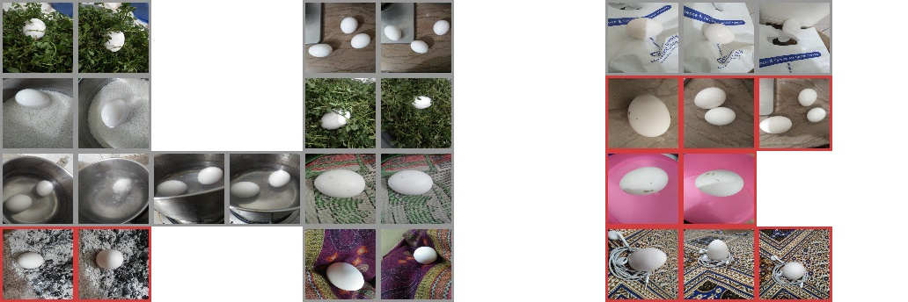

The eval split is evaluated once, in Section 4, after the algorithm was frozen on dev results (`experiments/final_config.json`, frozen at commit `aed2c40c`).

## 2. Task 1 - segmentation with a pretrained model (SAM)

**Method.** The dataset has no prompts, so SAM ViT-B (official `segment-anything` package, CPU) runs in *segment-everything* mode (16x16 grid of point prompts, predicted-IoU >= 0.86, stability >= 0.92).
The candidate masks are cached and then filtered to eggs: area 1.2-50% of the image, solidity >= 0.93, ellipse-fit IoU >= 0.88, axis ratio <= 2, mean HSV saturation <= 60 and brightness >= 100,
border-touching masks must be >= 3% of the image with ellipse-IoU >= 0.93, and greedy NMS (IoU 0.3 / containment 0.8). The colour thresholds were chosen from the measured gap between the first false positives
(skin and leaf: saturation 77 and 124) and true eggs (<= 33). Output: one instance-id PNG per image (`outputs/sam_masks/`).
Benchmark on one image (4 CPU cores): SAM benchmark (CPU, 4 cores, 1 image 640x640, official segment-anything, AutomaticMaskGenerator)<br>vit_b pps=16: 31.4 s, 12 candidate masks<br>vit_b pps=32: 99.0 s, 23 candidate masks<br>vit_l: not benchmarked to completion (expected >2x slower; ~2.5-3 h for 110 images) -> dropped<br>Chosen: vit_b, pps=16 (~1 h for the dataset).

**Manual corrections (disclosure).** The automatic selection found no egg in 10 of the 110 images and gave ragged or wrong masks in a few others, so 15 images were corrected by giving SAM hand-drawn **box prompts**
(box coordinates read by eye from the overlays, stored in `scripts/sam_manual_fixes.json`). For eggs half hidden by leaves or a bar, the convex hull of the prompted mask was used (eggs are convex).
These 15 images are the hardest ones, so the SAM ground truth there is partly a human judgement.

| image | action | why |
|---|---|---|
| 10 | replace | egg partly covered by leaves/stem and visible in two pieces; automatic mask was ragged |
| 11 | replace | egg in leaves not found automatically |
| 12 | replace | egg in leaves not found automatically |
| 13 | replace | egg in leaves, automatic mask ragged |
| 117 | replace | white egg in white egg tray, split in two by a bar and a shaded cavity edge; not found automatically |
| 123 | replace | white egg on white bag, automatic mask ragged |
| 124 | replace | egg in boiling water not found automatically |
| 125 | replace | white egg on white bag not found automatically |
| 135 | replace | egg in boiling water (image is in Roboflow 'Unlabeled' folder but an egg is visible) |
| 145 | replace | egg in boiling water (image is in Roboflow 'Unlabeled' folder but an egg is visible) |
| 144 | add | third egg, partly hidden behind the other two, missed automatically |
| 16 | remove | earphone case wrongly segmented as an egg |
| 20 | replace | backlit egg in hand not found automatically |
| 24 | replace | backlit egg in hand not found automatically |
| 44 | replace | large out-of-focus egg in hand not found automatically |

**Result.** 138 eggs in 110 images (1 egg: 93 images, 2 eggs: 6, 3 eggs: 11). Figure 2 shows 40 of the 110 results (the full set is in `outputs/sam_review_*.jpg`).
Limits: the masks are used as ground truth in Task 3 but are not perfect (e.g. eggs on leaves, backlit eggs, white-on-white boundaries), so every metric below measures *agreement with SAM*, not with a human annotation.

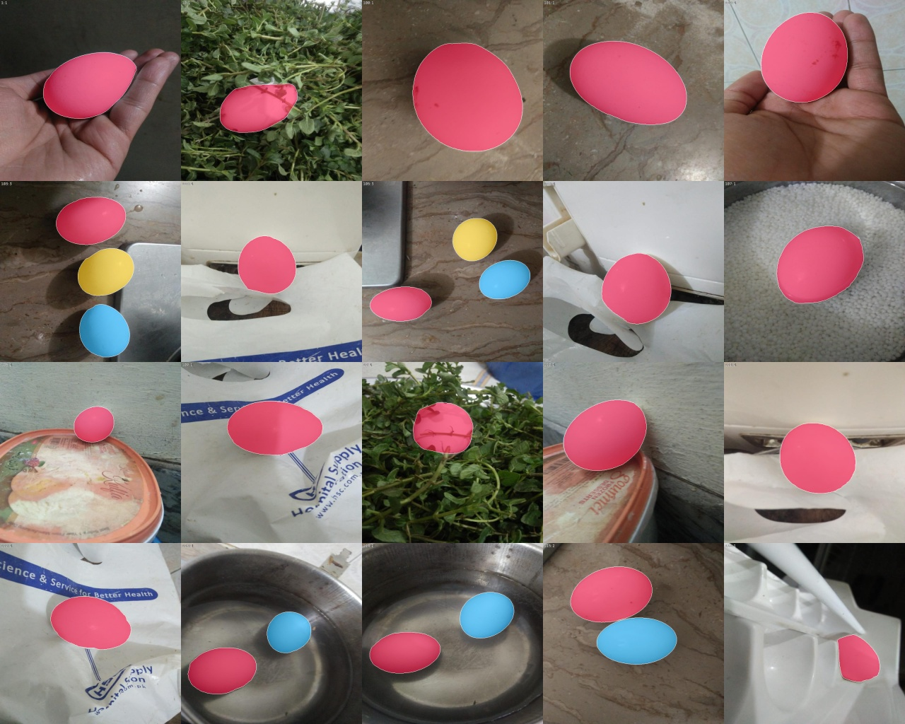
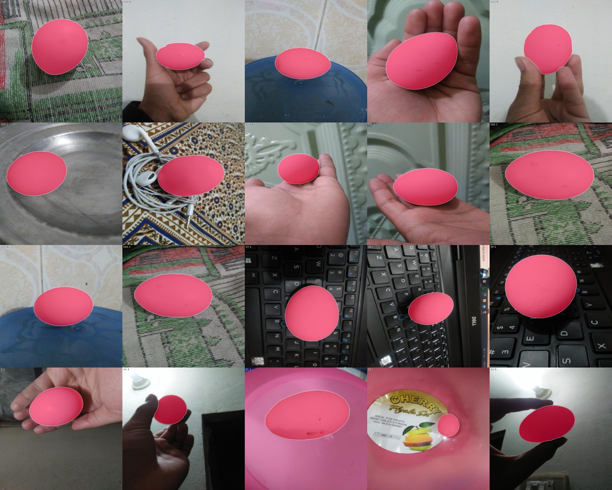

## 3. Task 2 - segmentation with classical image processing

**Final algorithm** (`src/eggseg/classical.py`, function `segment`, config below). Eggs are bright, convex, elliptical and white, but no single threshold isolates them in every image
(a white egg on a white bag merges with it), so instead of picking one threshold:

1. Build three feature maps: gray; *whiteness* = V - 0.8 S (HSV); and the Lab colour distance to the 3 dominant colours of the image border (background colours).
2. Threshold each map at ~34 levels (40..240 step 6); at every level clean with open/close and take every connected component as an **egg candidate**.
3. Score each candidate: ellipse-fit IoU x solidity (does it look like an egg?) x boundary contrast (Lab distance between its inside and a 9 px ring around it) x area^0.5 (prefer the whole egg over its highlight);
   reject candidates larger than 50% of the image, with solidity < 0.9, ellipse-IoU < 0.85, axis ratio > 2.2 or mean saturation > 70.
4. Greedy non-maximum suppression keeps the best non-overlapping candidates (one per egg).
5. **GrabCut** (10 iterations) seeded from each candidate (sure foreground = candidate eroded by 0.5 radius, sure background = farther than 1 radius) moves the boundary to the real egg edge.
6. If no candidate passed, repeat with relaxed thresholds (solidity >= 0.8, ellipse-IoU >= 0.7, no colour gate) and keep the single best one (every dataset image has an egg).

```
{
 "max_area": 0.5,
 "min_solidity": 0.9,
 "min_ellipse_iou": 0.85,
 "max_axis_ratio": 2.2,
 "cand": "sweep",
 "score": "shape_contrast",
 "sweep_feats": [
  "gray",
  "whiteness",
  "bgdist"
 ],
 "max_sat": 70,
 "area_w": 0.5,
 "grabcut": true,
 "fallback": true,
 "gc_iters": 10,
 "gc_shrink": 0.5
}
```
(all other parameters are the defaults in `classical.BASE`).

**Experiment log.** 27 trials, all measured on the 88 dev images only, against the SAM masks. Every trial is a config in `experiments/trials.py`; full parameters, reasoning and the verdict
of each trial are in [`experiments/LOG.md`](../experiments/LOG.md) (generated from `results.csv`). Metrics: IoU/Dice/BF are means over images (BF = boundary F1 with 3 px tolerance); inst-F1 = per-egg F1 at IoU >= 0.5; count-acc = fraction of images with the right number of eggs.

| id | trial | IoU | Dice | BF | inst-F1 | count-acc | decision |
|---|---|---|---|---|---|---|---|
| T0 | Gray + Otsu (baseline) | 0.319 | 0.430 | 0.200 | 0.255 | 0.32 | reference |
| T1 | HSV-V channel + Otsu | 0.287 | 0.388 | 0.190 | 0.235 | 0.33 | discarded |
| T2 | Whiteness (V - 0.8*S) + Otsu | 0.317 | 0.427 | 0.196 | 0.243 | 0.33 | discarded alone, reused later |
| T3 | Lab L* + Otsu | 0.277 | 0.383 | 0.171 | 0.196 | 0.28 | discarded |
| T4 | Adaptive (local mean) threshold | 0.162 | 0.256 | 0.165 | 0.039 | 0.01 | discarded |
| T5 | T0 + shape/size filter | 0.189 | 0.211 | 0.138 | 0.225 | 0.24 | kept as a component |
| T6 | Colour distance from border colours | 0.225 | 0.272 | 0.141 | 0.278 | 0.35 | discarded as a generator, feature reused |
| T7 | Multi-threshold sweep + shape score (gray) | 0.420 | 0.517 | 0.265 | 0.408 | 0.57 | kept |
| T8 | Canny edge loops + shape score | 0.200 | 0.213 | 0.200 | 0.207 | 0.14 | discarded |
| T9 | T7 + boundary-contrast score | 0.438 | 0.535 | 0.282 | 0.450 | 0.57 | kept |
| T10 | T9 + pool gray/whiteness/border-distance sweeps | 0.480 | 0.581 | 0.315 | 0.481 | 0.56 | kept |
| T11 | T10 + relaxed shape thresholds | 0.442 | 0.566 | 0.288 | 0.395 | 0.30 | discarded |
| T12 | T10 + white-egg colour gate | 0.494 | 0.596 | 0.319 | 0.485 | 0.59 | kept |
| T13 | T12 + stronger smoothing | 0.470 | 0.570 | 0.277 | 0.465 | 0.53 | discarded |
| T14 | T12 + prefer larger candidates | 0.497 | 0.593 | 0.332 | 0.523 | 0.60 | kept |
| T15 | T14 + GrabCut refinement | 0.573 | 0.652 | 0.472 | 0.617 | 0.59 | kept |
| T16 | T15 + GrabCut sanity limits | 0.559 | 0.640 | 0.458 | 0.583 | 0.59 | discarded |
| T17 | T16 + relaxed fallback when nothing found | 0.588 | 0.678 | 0.480 | 0.615 | 0.66 | informative only |
| T18 | T17 + centre prior | 0.587 | 0.680 | 0.477 | 0.606 | 0.67 | discarded |
| T19 | T15 + relaxed fallback (clean re-run) | 0.599 | 0.689 | 0.485 | 0.650 | 0.68 | kept |
| G1 | GrabCut grow 0.6 | 0.587 | 0.676 | 0.470 | 0.637 | 0.69 | discarded |
| G2 | GrabCut grow 1.5 | 0.600 | 0.690 | 0.487 | 0.637 | 0.67 | discarded (neutral) |
| G3 | GrabCut shrink 0.2 | 0.598 | 0.686 | 0.491 | 0.650 | 0.69 | discarded (neutral) |
| G4 | GrabCut shrink 0.5 | 0.605 | 0.693 | 0.494 | 0.651 | 0.68 | kept (in F1) |
| G5 | GrabCut 10 iterations | 0.615 | 0.702 | 0.517 | 0.655 | 0.66 | kept (in F1) |
| F1 | Combine: GrabCut 10 iters + shrink 0.5 | 0.618 | 0.703 | 0.512 | 0.666 | 0.68 | FINAL |
| F2 | F1 + 20 GrabCut iterations | 0.618 | 0.699 | 0.516 | 0.638 | 0.69 | discarded |

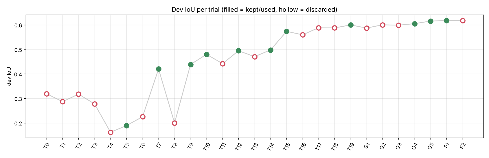

**How the experiments led to the algorithm.**

- **T0** - Gaussian blur 5, grayscale, global Otsu threshold, open 5 / close 9, every component 0.4%-75% of the image kept. *Why:* simplest possible classical baseline: eggs are brighter than most backgrounds. *Result:* Baseline, dev IoU 0.319. Failure analysis: (a) a white egg on a bright background merges with it into one huge blob that max_area rejects -> egg missed; (b) hands, tiles, metal pans selected as giant false positives.
- **T1** - feature = V of HSV instead of gray. *Why:* V is max(R,G,B): keeps white and cream eggs bright even if slightly tinted. *Result:* 0.287 < 0.319: V=max(R,G,B) brightens coloured backgrounds as well, so more background joins the egg blob.
- **T2** - feature = V - 0.8*S (bright AND unsaturated). *Why:* eggs are white; skin, rugs, bowls are bright but saturated. *Result:* 0.317 ~ T0 (no gain with a global threshold), but whiteness (V-0.8S) separates white from skin/rug, so it became one of the feature maps pooled in T10 and the video detector.
- **T3** - feature = L* of CIELAB. *Why:* L* is perceptual lightness, less dominated by green than gray. *Result:* 0.277, worst of the single-channel thresholds; L* behaves like gray.
- **T4** - adaptive threshold block 51, C=-8 instead of global Otsu. *Why:* global threshold fails when background brightness varies; local one only needs the egg to be brighter than its neighbourhood. *Result:* 0.162, instance F1 0.039: a local-mean threshold fires on every texture edge and outlines instead of filling the egg.
- **T5** - keep only components with area <= 50% of image, solidity >= 0.90, ellipse-fit IoU >= 0.85, axis ratio <= 2.2. *Why:* T0 failures were giant background blobs and hands; eggs are small, convex, elliptical. *Result:* IoU falls to 0.189 and instance F1 from 0.255 to 0.225 on its own, because rejecting giant blobs leaves nothing in their place. Kept only as a component: every later candidate generator (T6-T8 and the final sweep) needs the shape/size filter to rank candidates.
- **T6** - feature = min Lab distance to 3 k-means colour clusters of a 24 px border ring (x3), Otsu, plus T5 shape filter. *Why:* eggs are usually centred; whatever colours appear on the border are background, so 'unlike the border' = egg. *Result:* 0.225: backgrounds with several colours (rug, keyboard, tiles) make 'different from the border' true almost everywhere. The bgdist feature was still useful as one of three maps in T10.
- **T7** - threshold gray at levels 40..240 step 6; every component at every level is a candidate scored by ellipse-IoU*solidity; greedy NMS. *Why:* no single threshold separates the egg in every image; some level usually isolates an egg-shaped blob. *Result:* 0.420 (+0.10 over T0): sweeping thresholds and scoring components by ellipse-IoU x solidity finds an egg-shaped blob at some level even when no single threshold works. Remaining failures: the sweep ranks egg-shaped non-eggs (foil patch, thumb, cloth corner) above the egg.
- **T8** - Canny 30/90 on blurred gray, close gaps with 7 px ellipse, fill every closed contour, shape-score, NMS. *Why:* white eggs on white backgrounds still have a faint closed shadow/edge outline that thresholds cannot see. *Result:* 0.200: Canny edges rarely close into one loop around the egg; white-on-white eggs have almost no edge, and textured backgrounds produce many spurious loops.
- **T9** - candidate score = ellipse-IoU*solidity * min(dE,40)/40, dE = Lab distance between mean colour inside and in a 9 px ring outside. *Why:* T7 picked egg-shaped blobs with no real boundary (foil patch, cloth corner, thumb); a real egg differs from its surroundings. *Result:* 0.438 (+0.018): requiring a visible colour boundary removes boundary-less shape coincidences.
- **T10** - run the sweep on three feature maps (gray, whiteness, bgdist) and pool all candidates before NMS. *Why:* eggs that are not brighter than the background (ash, tray) may still stand out in whiteness or colour-vs-border. *Result:* 0.480 (+0.042): the same egg is isolated in different feature maps (gray / whiteness / border distance); pooling candidates and letting NMS pick the best recovers ash and tray eggs.
- **T11** - min solidity 0.90->0.85, min ellipse-IoU 0.85->0.80, axis ratio 2.2->2.5. *Why:* textured/occluded eggs give ragged masks that fail the strict filter. *Result:* 0.442 < 0.480, count accuracy fell 0.56 -> 0.30: relaxing solidity/ellipse thresholds admits many non-egg blobs.
- **T12** - reject candidates whose mean HSV saturation > 70 (0-255). *Why:* eggs here are white/cream; coloured blobs (skin, rug, orange box) should lose. *Result:* 0.494 (+0.014): rejecting candidates with mean saturation > 70 removes skin, rugs and orange boxes. This encodes a dataset prior (white/cream eggs) and would fail for brown eggs.
- **T13** - Gaussian blur 5 -> 11 and open/close 5/9 -> 7/15. *Why:* textured ash eggs fragment under thresholding; blurring merges the texture into one blob. *Result:* 0.470 < 0.494: stronger blur/morphology merges eggs with neighbouring objects and blunts the boundary; the ash eggs were not fixed.
- **T14** - score *= area_fraction ** 0.5. *Why:* the sweep often returns the bright highlight of an egg (small, very egg-shaped) instead of the whole egg. *Result:* 0.497 (+0.003 IoU, but boundary F1 0.319 -> 0.332 and instance F1 0.485 -> 0.523): preferring larger candidates stops the egg's bright highlight winning over the whole egg.
- **T15** - GrabCut (5 iters) seeded from each selected candidate: sure-FG = candidate eroded 0.35 r, sure-BG = beyond 1.0 r from it. *Why:* partial detections (egg highlights) should grow to the real egg boundary; ragged edges should snap to colour edges. *Result:* 0.573 (+0.076, boundary F1 0.332 -> 0.472): the largest single gain. GrabCut grows highlight-only detections to the real egg boundary and snaps ragged edges to colour edges.
- **T16** - fall back to the un-refined candidate if GrabCut result is > 2.5x the seed area or its ellipse-IoU < 0.80. *Why:* in T15 GrabCut sometimes flooded the background (huge false positives) when the seed was wrong or the background was similar. *Result:* 0.559 < 0.573: rejecting large GrabCut growth (>2.5x) or non-elliptical results also rejects legitimate growth from small highlights.
- **T17** - if no candidate passes, rerun with solidity >= 0.80, ellipse-IoU >= 0.70, no colour gate and keep the single best. *Why:* every image has >= 1 egg; complete misses (IoU 0) cost far more than a wrong guess. *Result:* 0.588: measured on top of the discarded T16 (fallback effect +0.029 vs T16). Superseded by the clean re-run T19.
- **T18** - candidate score *= exp(-d^2 / (2*0.5^2)), d = distance of its centroid from the image centre (normalised). *Why:* eggs are photographed roughly centred; off-centre blobs (bag corners, cloth) are usually distractors. *Result:* 0.587 vs 0.588: the centre prior changes nothing measurable, and would hurt off-centre eggs and the video.
- **T19** - fallback = True on top of T15 (T16's GrabCut limits and T18's centre prior are NOT included). *Why:* T17 measured the fallback on top of the discarded T16; this isolates its effect on the kept pipeline. *Result:* 0.599 (+0.026 vs T15): when no candidate passes, relax solidity/ellipse thresholds and keep the best one. Every dataset image contains an egg, so a guess beats an empty mask. Dataset-specific: for video frames with no egg this fallback must be off.
- **G1** - gc_grow 1.0 -> 0.6. *Why:* smaller search radius = less leakage into background. *Result:* 0.587 < 0.599: a smaller GrabCut search radius prevents small seeds growing to the full egg.
- **G2** - gc_grow 1.0 -> 1.5. *Why:* larger radius lets tiny highlight seeds grow to the whole egg. *Result:* 0.600 vs 0.599: no measurable change, larger radius raises leakage risk.
- **G3** - gc_shrink 0.35 -> 0.2 (sure-FG core eroded less). *Why:* bigger sure-foreground core anchors the colour model. *Result:* 0.598 vs 0.599: no change.
- **G4** - gc_shrink 0.35 -> 0.5. *Why:* smaller core lets GrabCut correct seeds that overshoot the egg. *Result:* 0.605 (+0.006): a smaller sure-foreground core lets GrabCut correct seeds that overshoot.
- **G5** - gc_iters 5 -> 10. *Why:* more EM iterations may converge to better colour models. *Result:* 0.615 (+0.016, boundary F1 0.485 -> 0.517): more EM iterations improve the colour models.
- **F1** - gc_iters 10 and gc_shrink 0.5 together (G5 + G4). *Why:* the two best single-parameter changes from the grid; check they add up. *Result:* 0.618: G4 + G5 combine. Frozen as the final algorithm; this config is the only one evaluated on the eval split.
- **F2** - gc_iters 10 -> 20. *Why:* the trend G5 > T19 suggests more iterations may still help; check for saturation. *Result:* 0.618 = F1, instance F1 fell 0.666 -> 0.638: iterations have saturated; 2x slower.

*In short:* global thresholds (T0-T4) cannot separate a white egg from a bright background, they either merge them or pick the dim table reflection/background instead. Moving from "one threshold" to "many thresholds, choose the most egg-shaped component" (T7) was the first real gain;
then every addition fixed a specific failure seen in the dev error overlays: wrong egg-shaped blobs (contrast, T9), eggs invisible in one feature map (pooling, T10), skin/rugs (colour gate, T12), highlights instead of whole eggs (area prior, T14) and rough boundaries/partial eggs (GrabCut, T15, the biggest gain);
the fallback (T19) removed empty results. Unsuccessful attempts that were kept in the log on purpose: HSV-V and L* thresholds, adaptive threshold, border-colour distance as the only generator, Canny loops, relaxed shape thresholds, more smoothing, limiting GrabCut, a centre prior.

## 4. Task 3 - evaluation and analysis

Ground truth = SAM masks (Task 1), prediction = final classical algorithm, **eval split (22 images, evaluated once)**; dev numbers are shown for reference.
Definitions: *semantic* metrics merge all eggs into one foreground mask (IoU = TP/(TP+FP+FN), Dice, pixel precision/recall); *boundary F1* counts an edge pixel as correct if a GT edge pixel is within 3 px (and vice versa), HD95 is the 95th-percentile
edge-to-edge distance; *per-egg* metrics match predicted and GT eggs one-to-one (Hungarian) and count a match when IoU >= 0.5. Images with no egg in both masks would score 1; none occur here.

| metric | eval (22 images, held out) | dev (88 images, used for tuning) |
|---|---|---|
| IoU (mean per image) | 0.594 | 0.619 |
| IoU (median) | 0.724 | 0.687 |
| Dice | 0.667 | 0.704 |
| pixel precision | 0.729 | 0.751 |
| pixel recall | 0.684 | 0.750 |
| boundary F1 (3 px) | 0.580 | 0.516 |
| HD95 (px, mean) | 118.6 | 123.9 |
| per-egg precision (IoU>=0.5) | 0.587 | 0.641 |
| per-egg recall | 0.697 | 0.739 |
| per-egg F1 | 0.618 | 0.667 |
| mean IoU of matched eggs | 0.815 | 0.843 |
| micro IoU (pooled pixels) | 0.472 | 0.538 |
| images with IoU >= 0.5 | 64% | 70% |
| images with IoU >= 0.8 | 45% | 39% |
| right egg count | 73% | 68% |

Eval and dev agree within sampling noise (22 images is a small sample; the eval per-image IoU standard deviation is 0.37), so tuning on dev did not obviously overfit.
The distribution is **bimodal** (Figure 4): 45% of eval images are good (IoU >= 0.8, matched-egg IoU 0.81) while 36% fail badly, so the mean (0.594) hides two very different regimes.

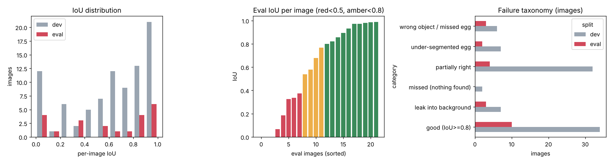

### Qualitative evaluation: the eight worst eval images
Columns: image | SAM (ground truth) | classical prediction | error map (green = correct, red = false positive, blue = missed egg).

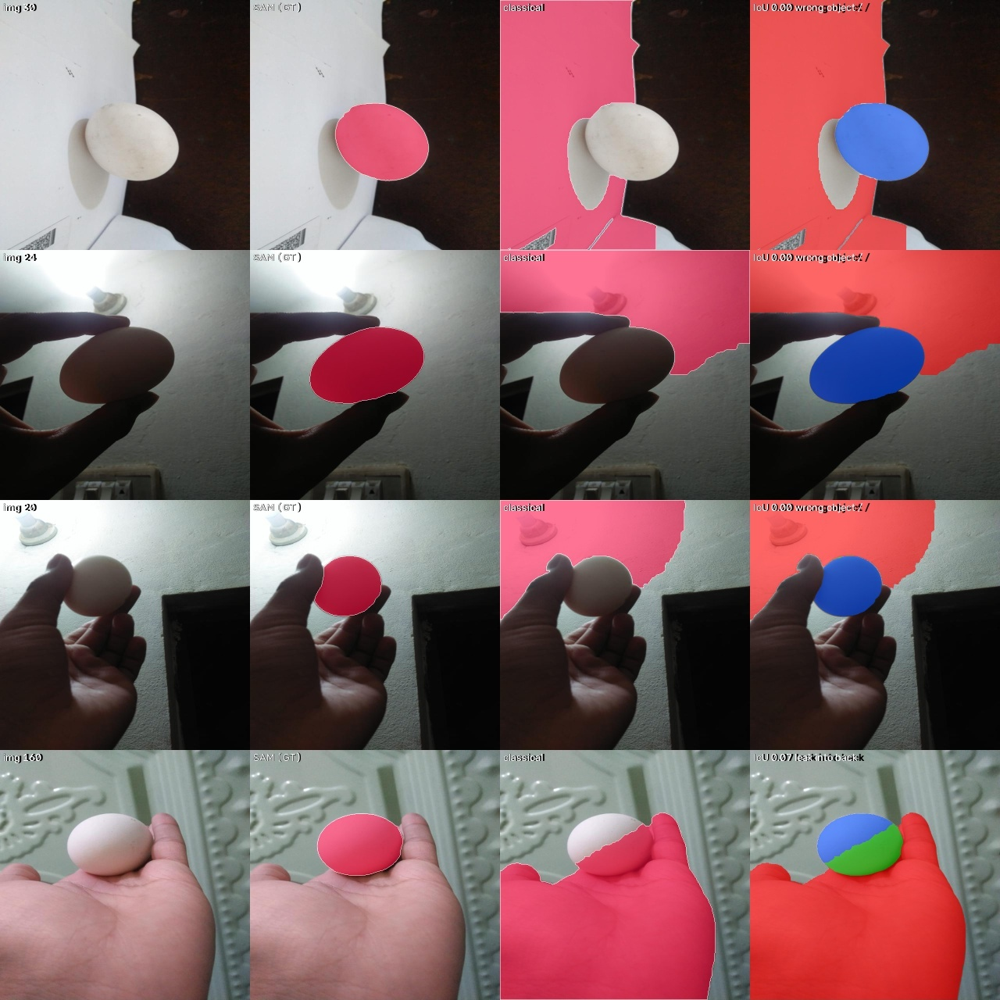
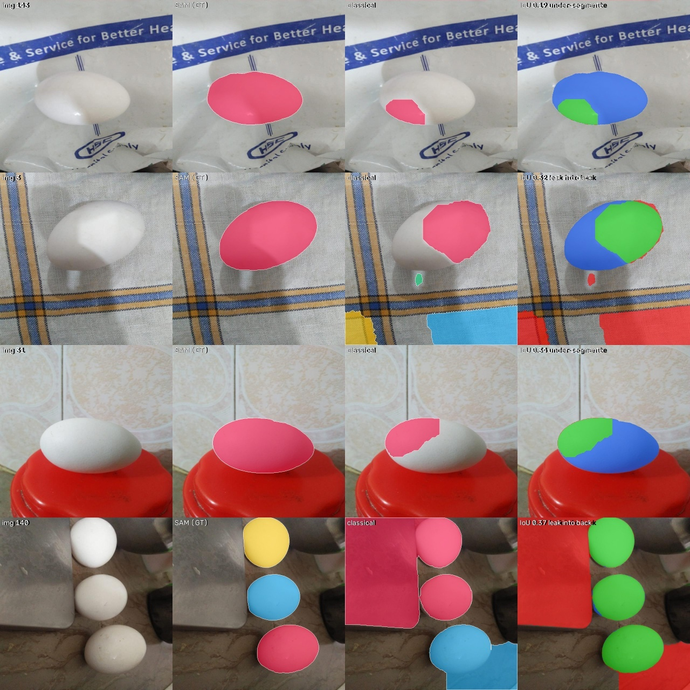

What went wrong (matching the rows of Figure 5):

- **Low contrast egg on a bright background (images 30, 143, 3, 31):** a white egg on a white wall/bag/cloth/bowl. The sweep does not find the whole egg: either the egg merges with the background (image 30: the prediction is the white paper), or only its brightest part is found (143, 3, 31: the shaded half of the egg is missed, 'under-segmented').
  A likely reason why GrabCut does not recover the shaded half is that its colour is closer to the background than to the lit half (not verified separately).
- **Dark egg on a bright background (images 24, 20, backlit hand-held eggs):** the method assumes *bright egg*; here the egg is darker than the wall, so the prediction is a patch of bright wall (0 IoU).
- **Skin-coloured surroundings (image 160):** the predicted region covers the palm instead of the egg ('leak into background'); a pale palm has low saturation, so the white-egg colour gate does not reject it.
- **Large flat objects (image 140):** a large grey region (the metal plate) is predicted as an egg, probably because a smooth, bright, convex region passes the shape test after GrabCut rounds it off; the lowest egg also merges with the table.

Best cases for contrast (egg on a contrasting, smooth surface, IoU 0.97+):

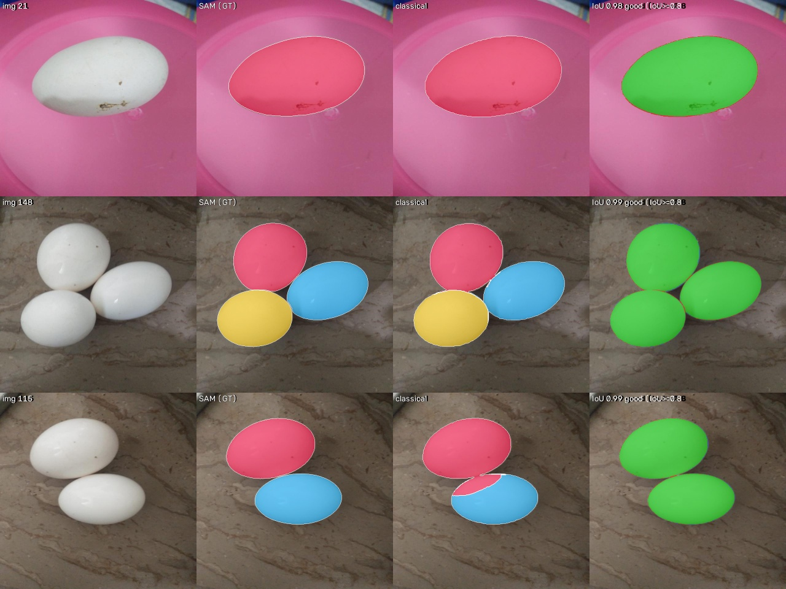

### Quantitative error analysis (all 110 images pooled, descriptive only)

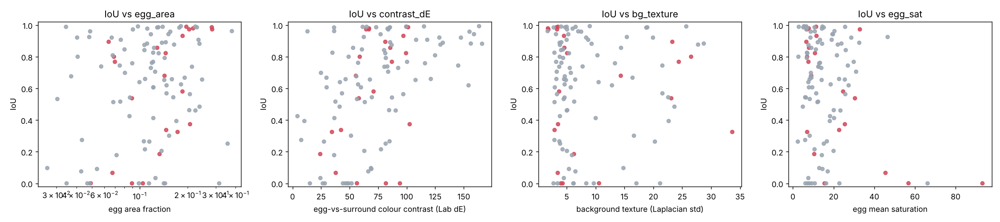
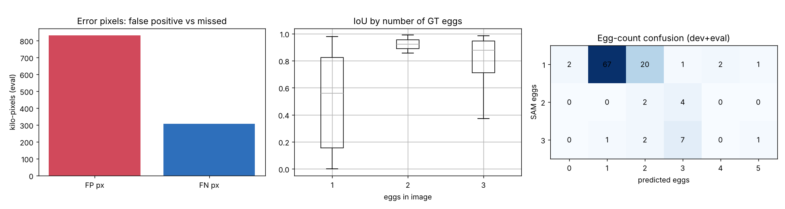

- **Over-segmentation dominates.** False-positive pixels outnumber missed pixels 2.7:1 on eval (1.8:1 pooled); pixel precision 0.73 vs recall 0.68. GrabCut and the relaxed fallback grow into the background more often than they miss egg pixels.
- **Contrast is the strongest factor.** Mean IoU is 0.43 (n=43) vs 0.73 (n=67) for images where the egg differs from its surroundings by Lab dE < 60 vs >= 60 (Figure 7, second panel).
- **Small eggs are harder:** egg area < 5% of the image: 0.45 (n=14) vs 0.64 (n=96).
- **Saturated (non-white) eggs fail:** egg mean saturation >= 40 (brown/pinkish, backlit): 0.20 (n=5) vs 0.63 (n=105) - these are rejected by the white-egg colour gate, which is a deliberate dataset prior and the reason this method would not transfer to brown eggs.
- **The hard images are hard for SAM too:** the 15 images that needed manual SAM prompts: 0.45 (n=15) vs 0.64 (n=95).
- **Wrong object beats no object.** 18 of 110 images have IoU < 0.2, but only 2 of them have an empty prediction: the relaxed fallback and the candidate scoring usually pick a *wrong* region (Figure 5), which is worse than a miss for any downstream use.
- **Counting:** the right egg count in 73% of eval images. In single-egg images (93 of 110) the method predicts more than one egg in 24 cases (26%), i.e. spurious extra eggs (Figure 8, right); in the 17 multi-egg images the count is right for 9.
  Multi-egg images score higher (IoU 0.70 vs 0.60 for single-egg); in the galleries they are mostly on contrasting surfaces such as a marble counter or water in a pan (an observation, not tested).
- **Boundaries:** where an egg is found, the boundary is decent (matched-egg IoU 0.81, boundary F1 0.58), but HD95 is 119 px on average because the failures are far away from the egg.

### Where the algorithm should be improved
1. **Remove the bright-egg assumption**: also sweep inverted feature maps (dark egg on a bright wall) and let the contrast/shape score decide (images 24, 20).
2. **Shading-aware egg model**: a lit egg has a smooth, monotone brightness gradient and a shadow side. Fitting an ellipse to *both* the lit part and the adjacent shaded part (e.g. an ellipse-constrained GrabCut, or growing the candidate along smooth gradients) would fix the half-egg failures (143, 3, 31).
3. **Constrain GrabCut**: after refinement fit an ellipse and fall back (or intersect with the dilated ellipse) if the mask leaves it; T16 showed that a crude size limit hurts, so the constraint should be shape-based, not size-based.
4. **Explicit skin and large-object rejection**: a skin detector in YCrCb and a limit on candidate size relative to the *median* candidate would stop the hand/plate leaks (160, 140).
5. **Learn the candidate score**: the current score is a hand-weighted product; a small classifier (logistic regression / gradient-boosted trees on the shape, contrast, colour and position features already computed here) trained on the dev candidates, labelled by IoU with SAM, would weight them properly while staying classical.
6. **Count prior**: penalise a 2nd/3rd egg unless it is also well supported (the 24/93 spurious second eggs).
7. **Better ground truth**: some SAM masks are themselves uncertain (leaves, backlit); a second pretrained model or manual review of the eval images would give a more trustworthy upper bound.

## 5. Task 4 - video tracking

**Video.** Screen recording of a 59 s clip (1912x1074, 30 fps, 1779 frames) of two white eggs on a dark table which a hand touches and spins. Only frames ~177-1150 show the eggs; the rest are title/text cards and the YouTube interface with a recommended-videos grid
(whose egg thumbnails would otherwise create false tracks).

**Pipeline** (`scripts/05_track_video.py`, `src/eggseg/tracking.py`).

1. *Scene gate:* a frame is processed only if > 25% of its lower half is dark brown (the table); this selects exactly frames 177-1150 as one run.
2. *Segmentation (adapted from Task 2):* frame resized to 640x360; the *whiteness* feature thresholded at a **fixed** value of 200, open/close, then the same shape filter (solidity >= 0.9, ellipse-IoU >= 0.85, axis ratio <= 2.2). The two Task-2 features that were switched off: Otsu (it picked the dim table
   reflections under the eggs and missed the eggs: observed on frames 323-484, so it was replaced by a fixed threshold) and the sweep/GrabCut stages (a 16x slower sweep variant was tried and gave almost the same number of two-egg frames, 224 vs 220 of 323 sampled, so it was dropped).
3. *Tracking (SORT-style):* every egg is a track with a constant-velocity **Kalman filter** over its box (centre, width, height). Per frame: predict all tracks; cost = 0.5 (1 - IoU) + 0.5 x distance/gate between predicted boxes and detections;
   **Hungarian** assignment; matched tracks are corrected, unmatched detections start tentative tracks (confirmed after 8 detections), unmatched tracks coast on the prediction for 20 frames (shown as 'predicted').
4. *Re-identification:* the first version lost identities whenever the hand covered an egg for more than 20 frames (6 ids for 2 eggs); the presenter also moves eggs while they are hidden (one egg reappears ~0.5 frame widths away).
   Lost tracks are therefore remembered for 900 frames and a new track that reaches confirmation *inherits the id of the nearest lost track* (position + size) within 0.7 frame widths. This brought the result to exactly 2 ids.

**Result.** Output: `outputs/tracking/tracked.mp4` (masks, ids, 45-frame trails) uploaded to Google Drive: **LINK TO BE ADDED**; per-frame boxes in `outputs/tracking/tracks.csv`.
In the egg scene (frames 177-1150, 974 frames) egg 1 is shown in 98% of frames (detected in 96%), egg 2 in 70% (detected in 66%); both are shown in 70% of the frames. Total ids created: 2 for 2 eggs.

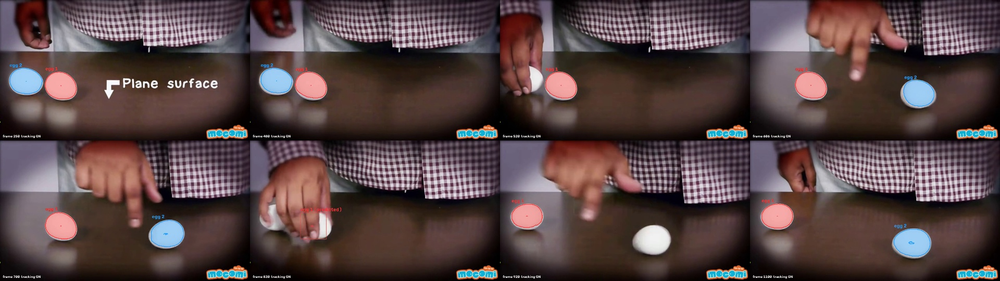
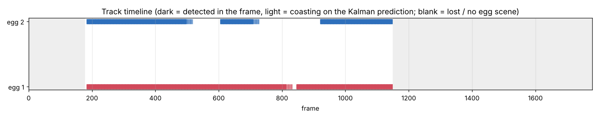

**Limitations.**

- *Egg 2 is the spinning egg:* it is blurred and often under the hand, so it is missed for ~34% of the scene frames (frame 920 is an example of a visible but undetected egg). After 20 frames without a detection a track stops being drawn until the egg is re-found.
- *Identity after occlusion is a best guess:* the two eggs look the same, so when both are hidden or an egg is moved while hidden the id can only be assigned from position and size. It happens to stay consistent in this clip, but there is no appearance cue to prove it (frames 500-850 are the critical part).
- *No tracking ground truth exists,* so no MOTA/IDF1 is reported; the numbers above are coverage and id counts, checked by watching the video.
- The detector is tuned for white eggs on a dark table (fixed threshold, scene gate); it is not the general Task-2 algorithm.

**Segmentation check against SAM on 20 sampled egg-scene frames.** With SAM masks (same egg filter as Task 1) as proxy ground truth, the video detector reaches mean IoU 0.73, Dice 0.83, boundary F1 0.69, per-egg F1 0.88.
SAM itself is not reliable on this video: it also segments the **table reflections under the eggs** as eggs (blue regions in Figure 11), finding more than 2 eggs in 6 of 20 frames. These reflections are SAM errors, but they lower the scores above (recall 0.73, precision 1.00: the detector never predicts anything SAM does not).
In the 11 of 20 frames where both find the same number of eggs the mean IoU is 0.88. This is a sanity check on mask quality, not a benchmark; the frames where an egg is under the hand (e.g. 790-890) are missed by both SAM-as-filtered and the detector.

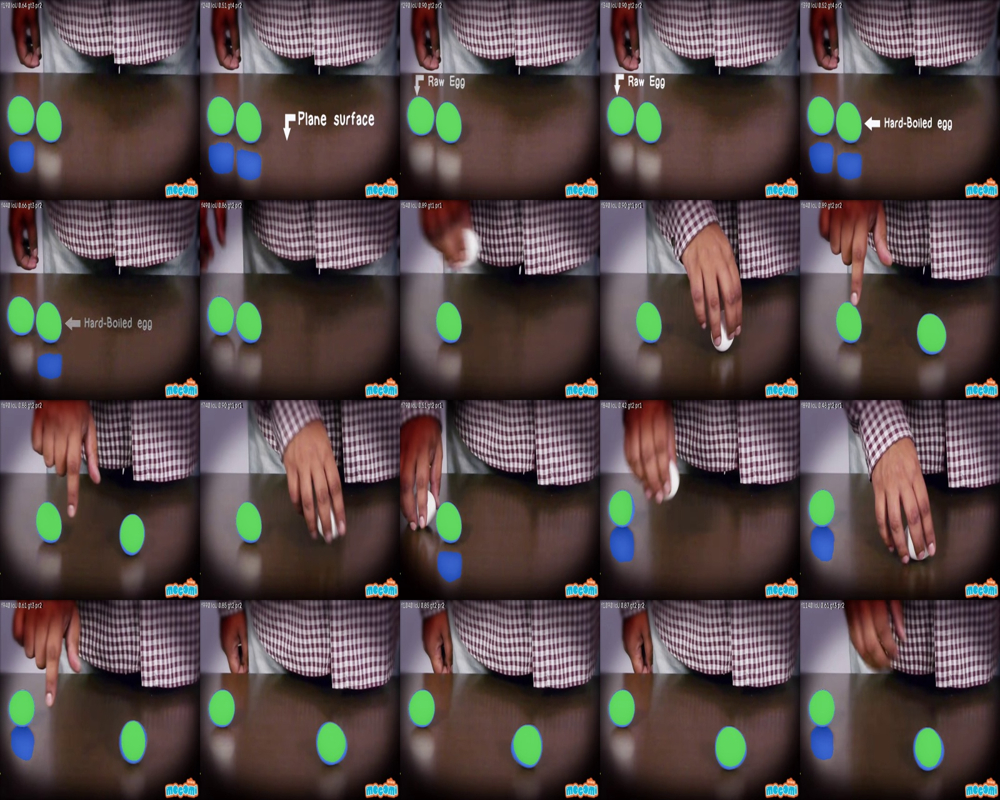

## 6. Reproducing the results
See the README ([https://github.com/derric01/nosh_assigment](https://github.com/derric01/nosh_assigment)): environment, data download and the numbered scripts (`scripts/01_run_sam.py` ... `scripts/08_build_report.py`), with expected CPU run times. Everything ran on 4 CPU cores without a GPU.

## 7. Use of AI tools
This work was done with Claude Code (Anthropic's AI coding assistant): it planned the work (`PLAN.md`), wrote the code, ran the experiments and drafted this report. All numbers, tables and figures in this report are produced by the scripts in the repository
(the experiment log and the report tables are generated from `results.csv`, `summary.json` and the per-image CSVs), and the keep/discard reasoning of each trial (`experiments/decisions.json`) was written after the trial's result had been measured.
Judgement calls that were made along the way and are disclosed above: the manual box-prompt corrections of 15 SAM masks, the dataset-specific priors (white eggs, at least one egg per image), the decision to treat the two `Unlabeled` images as egg images, and the video-specific scene gate.
